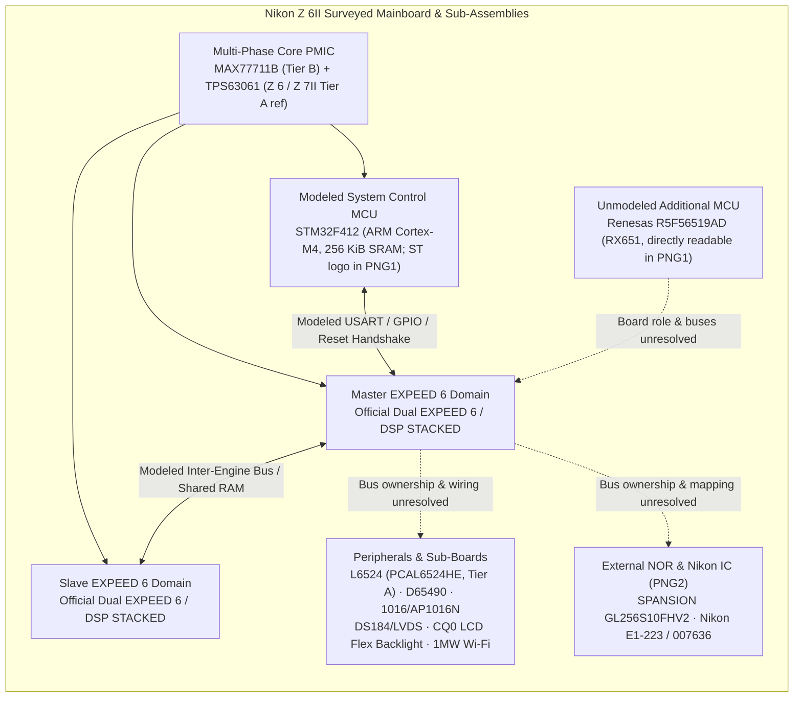
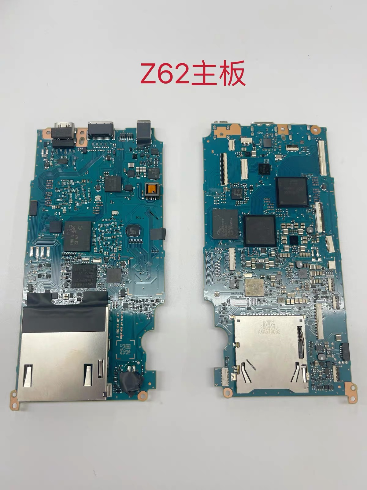
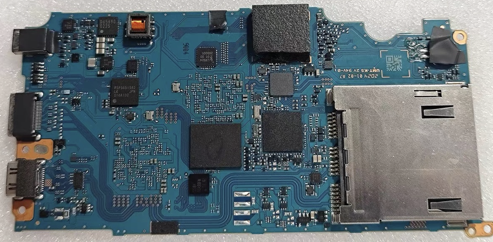
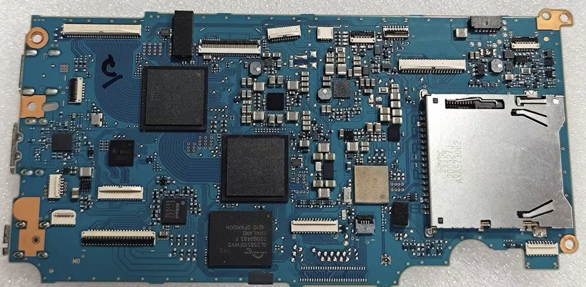
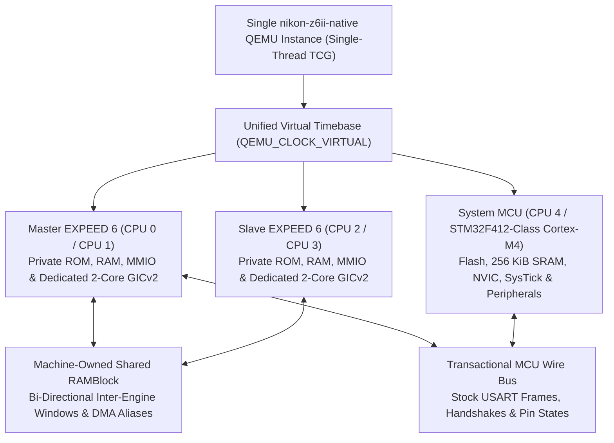
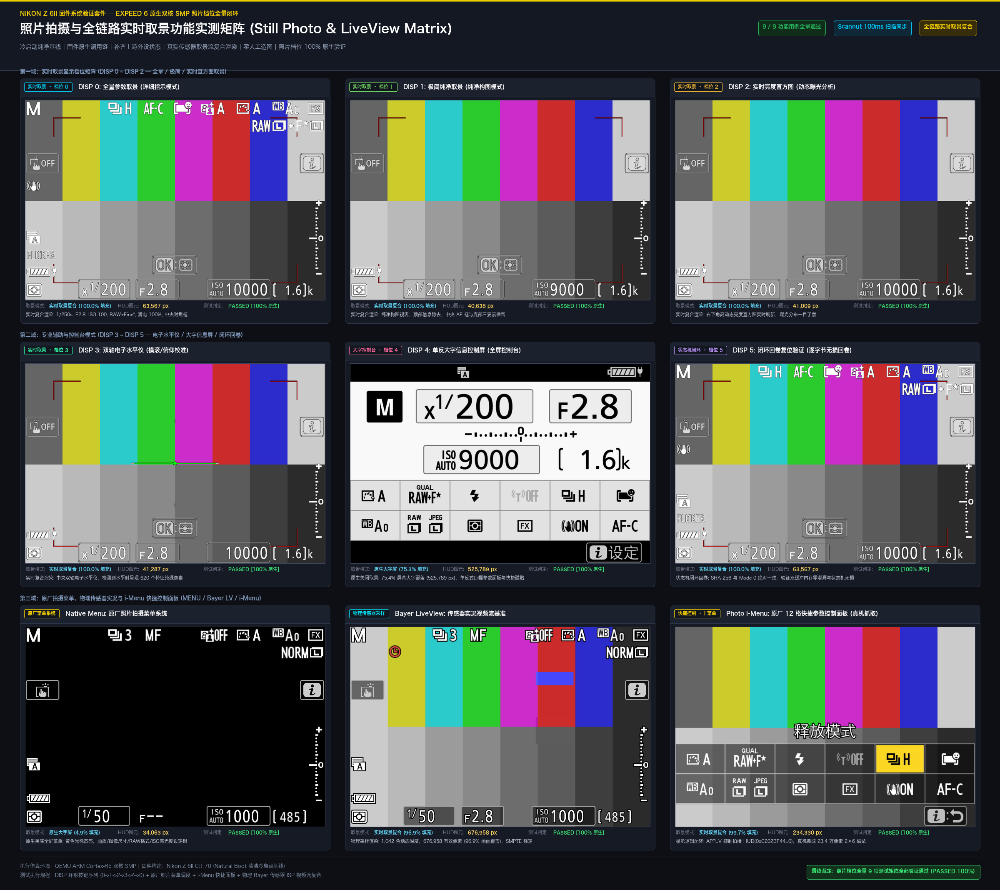
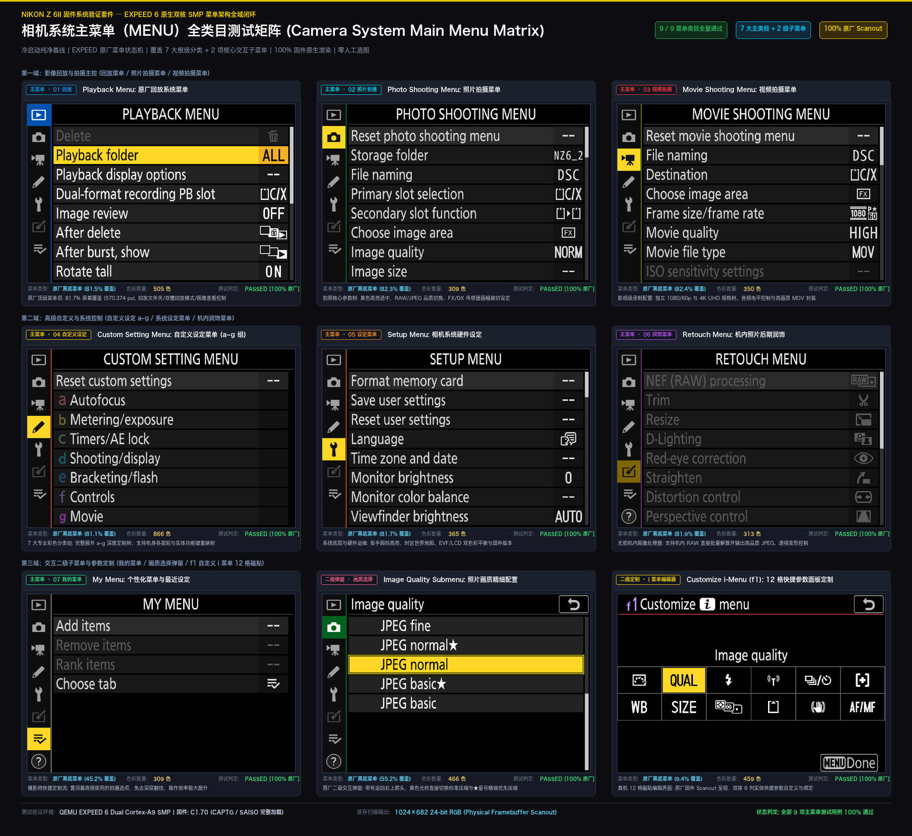

# Z62 QEMU v0.0.2 — Dual-EXPEED 6 System Emulation Research

[Motherboard Hardware Survey](#1-physical-motherboard--component-architecture-foundation) · [QEMU System & Clock Unification](#2-qemu-system-architecture--clock-unification) · [Two-Track Methodology](#3-two-track-emulation-methodology) · [Still-Photo & Menu Matrices](#4-still-photo-display--main-menu-preview-matrices) · [Repository Layout & Workflow](#5-planned-repository-layout--verification-workflow) · [Safety & Non-Infringing Policy](#6-safety-boundaries--non-infringing-policy) · [Full Hardware Notes](docs/motherboard-architecture.md) · [License & Notice](NOTICE.md)

**Current native method — v0.0.2 / V44:** [Native method and exposure milestone](docs/NATIVE-v0.0.2.md). Use `./z62 native --check-only` to verify published source/plan identities and `./z62 native` in a prepared installation to run the explicit exposure recipe. Original numerical publication and `30" / F-- / ISO AUTO 51200` LCD text are verified; changing-light metering and RAW/ISP completion remain pending.

**Historical comparison:** [Native Cold-Start Guide v0.01](docs/COLD-START-BASELINE-v0.01.md) and its frozen menu profile remain available as the earlier comparison point.

**Z62 QEMU** is an independent, educational QEMU 10.2.4 system emulation project targeting the **Nikon Z 6II (C 1.70)**. The current native machine implements **Dual EXPEED 6 (`EX1850`) + an STM32F412-class Cortex-M4 MCU**. User-confirmed Z62 photographs additionally show a **Renesas RX651 (`R5F56519AD`)** controller, whose firmware assignment and interfaces remain unresolved and are not yet modeled.

Our objective is to build a rigorous, full-system emulation model capable of running the camera's Asymmetric/Symmetric Multiprocessing (AMP/SMP) topology—spanning both dual-core EXPEED 6 application processors, the companion system-control MCU, shared inter-engine memory windows, interrupt routing, display composition, and still-imaging pipelines—within a safe, reproducible, host-side virtual machine.

> **Bring Your Own Firmware (BYOF) & Safety First.**  
> This repository is a **source-and-documentation-only** host-side emulator for hobbyist research and technical learning. **No Nikon firmware binaries, ROM dumps, cryptographic keys, or package extraction tools are included or downloaded.** It is **not** a camera-installable modification, firmware patcher, or hardware flashing utility, and it never performs write operations to a physical camera. See [Safety Boundaries & Non-Infringing Policy](#6-safety-boundaries--non-infringing-policy) and [NOTICE.md](NOTICE.md).

---

## 1. Physical Motherboard & Component Architecture Foundation

Before modeling the virtual machine, we conducted an evidence-tiered hardware survey correlating official Nikon specifications, public teardown disclosures (Z 6 / Z 7II), user-confirmed Z 6II PCB photographs, third-party repair component databases (`Nikon Z6 mark II` / `Z7 mark II`), and manufacturer datasheets. Full details, cross-generation comparisons, and native-machine consequences are documented in [docs/motherboard-architecture.md](docs/motherboard-architecture.md).

### Dual EXPEED 6 Platform vs. Modeled QEMU Domains

Nikon's official specification identifies **Dual EXPEED 6** on the **Nikon Z 6II (`Z62`)** and **Nikon Z 7II (`Z72`)** (upgraded from a single EXPEED 6 on the first-generation Z 6), alongside dual card slots (CFexpress Type B / XQD and UHS-II SD). The current `nikon-z6ii-native` QEMU implementation represents those two application-engine domains with **two CPU cores each**, plus one **STM32F412-class ARM Cortex-M4** controller (`5` emulated CPUs total). These five emulated CPUs describe our QEMU implementation rather than a verified physical core count or a complete factory Bill of Materials (BOM). User-confirmed Z 6II board photographs also show a separate **Renesas `R5F56519AD` (RX651)** 32-bit MCU, whose firmware and board connections are not yet mapped into the virtual machine:



### Evidence-Tiered Mainboard Component Matrix

Evidence origin (**direct photo reading**, **repair-database catalog**, **manufacturer datasheet**, or **QEMU modeling choice**) is recorded separately from the evidence tier (**Tier A**: datasheet-matched part number; **Tier B**: verified IC family/series; **Tier C**: short package top-code or tentative candidate):

| Subsystem Role | Recorded Board Marking | Matched IC Family / Part Candidate | Evidence Tier | Architectural Role & QEMU Emulation Relevance |
| :--- | :--- | :--- | :---: | :--- |
| **Primary Application Processors** | Official spec: **Dual EXPEED 6**; `DSP STACKED` in repair records | Nikon EXPEED 6; `EX1850` is the project/firmware engine label | **Official platform; implementation detail** | QEMU models Master (`CPU 0/1`) and Slave (`CPU 2/3`) as two ARM application-engine clusters with two emulated cores each. Neither the product spec nor the photos verifies that physical core topology. |
| **Modeled System-Control MCU** | `STM32F412` in repair records; ST logo visible in `PNG1` | STMicroelectronics **STM32F412** Cortex-M4 family | **Tier B; exact photo code unresolved** | QEMU's `CPU 4` is an STM32F412-class Cortex-M4 model (`256 KiB` SRAM, NVIC, SysTick, RCC, USART/DMA). `PNG1` does not independently resolve the full ST ordering suffix or prove every Nikon-specific duty. |
| **Additional MCU (Role Unresolved)** | `R5F56519AD` directly readable in `PNG1` | Renesas **RX651** 32-bit MCU series | **Direct photo + Tier B family match** | A distinct physical controller from the modeled Cortex-M4 (not limited to the Z 6 sibling board). Its firmware, reset relationship, and buses are not yet established; no RX651 CPU is currently modeled. |
| **External Flash Package** | `SPANSION GL256S10FHV2` directly readable in `PNG2` | Spansion / Infineon **S29GL-S** parallel NOR family | **Direct photo + family match** | Present on `PNG2`, but the photos do not identify its bus owner, address mapping, or stored firmware contents (corrects an earlier provisional `NANYA` label). |
| **Nikon-Marked IC (Role Unresolved)** | `Nikon E1-223 / 007636` directly readable in `PNG2` | Nikon top marking; exact device type unknown | **Direct photo; role unknown** | Corrects an earlier provisional `Micron` label; no memory, image-processing, or actuator role is assigned from this marking alone. |
| **Multi-Phase Core PMIC** | `MAX77711B` (plus `TPS63061` on Z 6 / Z 7II) | Analog Devices / Maxim **MAX77711** family + TI **TPS63061** | **Tier B / Tier A ref** | Configurable 4-phase buck regulator family shared by Z 6II and Z 7II dual-EXPEED mainboards (`B` suffix unconfirmed). |
| **Actuator-Driver Marking** | `D65490 / 0225` directly readable in `PNG1` | `D65490` repair-database entry | **Direct photo + Tier C function** | Cataloged in `photo-parts` under zoom/OIS/mirror-charge driver categories; does not prove mirror drive on a mirrorless body or specific Z 6II motor ownership. |
| **Motor / Actuator Driver** | `1016` | Mapped in repair records to **AP1016N** | **Tier C** | Candidate dual H-bridge motor/actuator driver; retained at Tier C pending independent datasheet verification. |
| **I²C/SMBus GPIO Expander** | Q-like symbol, `L6524 / 20 01 03 / ZSD005` directly readable in `PNG1` | NXP **PCAL6524HE**; manufacturer Table 1 maps `L6524` to HUQFN32 / SOT1426-1 (`5 × 5 × 0.56 mm`) | **Direct photo + Tier A manufacturer marking match** | Provides 24 GPIOs via Fm+ I²C/SMBus with independent `VDD(I2C-bus)` (`0.8–3.6 V`) and `VDD(P)` (`1.65–5.5 V`) level-translating domains (`PCAL6524HEHP` / `PCAL6524HEAZ` packing options indistinguishable by photo). Bus owner, address-pin setting, and GPIO/IRQ/reset wiring remain unresolved. |
| **Sibling DRAM / Sensor / Audio Refs** | `MT52L256M64D2LZ-107 WT:B`, `NT6CL512F64AH-H1`, `MMA8452`, `WM8962` | Micron/Nanya LPDDR3, NXP 3-axis accelerometer, Cirrus stereo codec (Z 6 / Z 7II records) | **Tier B sibling refs** | Contextualizes stacked/companion LPDDR3 memory, Virtual Horizon tilt sensing (`DISP 3`, Widget `0x3F`), and audio path interfaces across the Z-series EXPEED 6 family. |
| **Display, Wireless & LCD Flex Codes** | `DS184` (`DSI84`), `LVDS301`, `BD9867`, `TE4424RX`, `1MW Wi-Fi`, `CQ0` / `R1205L811C` | Display bridge codes, Wi-Fi module label, and off-mainboard LCD flex backlight driver | **Tier C** | Short repair-database markings without verified Z 6II board coordinates (`CQ0` / `R1205L811C` resides on the LCD flex assembly). |

### E-Commerce Replacement Board Imagery & Layout Scope (`Z 6II`)

While `photo-parts.com.ua` catalogs several IC markings for the `Nikon Z6 mark II`, its corresponding `"Nikon Z6 mark II PCB"` photo directory is empty. Our survey therefore combines user-confirmed high-resolution **Taobao** board photographs with **AliExpress** outline references:

<p align="center">
  
  
  
</p>

- **Taobao Replacement Mainboard Photos (`assets/z62-taobao-motherboard.jpg`, `assets/z62-taobao-motherboard-1.png` [`PNG1`], `assets/z62-taobao-motherboard-2.png` [`PNG2`])**: The two `2920 × 1436` PNGs (`PNG1` SHA-256: `4500f0eef42f3854ff62861295bb46ed2b0c7f6e0af5ca7b36c82fde6b1f56eb`; `PNG2` SHA-256: `99ffaf05d90eced787d215d9a9ba83e708c4747f92121a64f40199be9f855b70`) directly establish the package markings `R5F56519AD`, `D65490 / 0225`, `L6524 / 20 01 03 / ZSD005`, an ST logo (`PNG1`), `SPANSION GL256S10FHV2`, and `Nikon E1-223 / 007636` (`PNG2`), while the `1200 × 1600` `"Z62主板"` overview provides board-layout context. The two PNGs are not proven to depict the same physical assembly revision, and visible `2024 01-02 A7` / `UMT-KS 2V 94V-0` PCB text is not interpreted as Nikon's assembly revision or manufacture date.
- **Verified Numbered Overlays (`docs/assets/hardware/z62-user-board-20261025/annotations/`)**: `board-1-annotated.png` labels **1** Renesas `R5F56519AD` (RX651), **2** ST controller, and **3** `L6524` / `PCAL6524HE`; `board-2-annotated.png` labels **4** Spansion Flash (`GL256S10FHV2`) and **5** `Nikon E1-223`, with source/output hashes and marker coordinates recorded in `manifest.json` (locating visible packages without implying electrical nets or chip responsibilities).
- **AliExpress Reference Images (`Item 1005013051978470` [`1000 × 1000` CDN] & `Item 1005010161490916` [`800 × 800` CDN])**: Storefront replacement-board images used for macro PCB outline comparison only (a separate `Shop108460` watermarked screenshot was excluded for lack of an independently verifiable source).

**Methodological Limitation & Native-Machine Consequences**: Replacement-part photographs are not a traced schematic. While `PNG1` and `PNG2` locate `R5F56519AD`, `D65490`, `L6524`, `SPANSION GL256S10FHV2`, and `Nikon E1-223` visually on the board, image position alone does not identify electrical nets, pin assignments, bus ownership, or QEMU address maps, nor do these photos by themselves explain the observed battery `0x89` timeout. Short repair-database codes such as `BD9867`, `MAX77711B`, `R1205L811C`, `DS184`, and `TE4424RX` remain without verified board coordinates in this evidence set.
---

## 2. QEMU System Architecture & Clock Unification

The emulator has evolved from early three-module/multi-process split-clock experiments into a single QEMU machine—**`nikon-z6ii-native`**—executing the **five currently modeled CPU cores across three domains** under one shared **`QEMU_CLOCK_VIRTUAL`** timeline. The additional photo-confirmed RX651 is outside the current implementation scope. Once its firmware and interfaces are established, it should use the same machine and virtual timebase; a different oscillator frequency or instruction set does not require an independent elapsed-time clock.



### Silicon Domains, Address Spaces, and Interrupt Ownership

| Silicon Domain | Global QEMU CPU ID | Intra-Domain MPIDR | CPU Model | Memory Root & Interrupt Controller |
| :--- | :---: | :---: | :--- | :--- |
| **Master EXPEED 6** | `CPU 0`, `CPU 1` | `0`, `1` | `nikon-z6ii-a15-arm-cpu` | Private Master `AddressSpace` root; isolated 2-core GICv2 (`first-cpu-index = 0`) |
| **Slave EXPEED 6** | `CPU 2`, `CPU 3` | `0`, `1` | `nikon-z6ii-a15-arm-cpu` | Private Slave `AddressSpace` root; isolated 2-core GICv2 (`first-cpu-index = 2`) |
| **System MCU** | `CPU 4` | Single-core | `nikon-ex1850-m4-r0p1-arm-cpu` | Private MCU `AddressSpace` root; Cortex-M4 NVIC & SysTick (256 KiB SRAM) |

Key architectural properties enforced by the model and regression suite:

- **Isolated Per-Engine Address Spaces**: Both EXPEED 6 engines execute at overlapping virtual/physical addresses while backed by distinct `AddressSpace` roots. Internal DMA engines, MMIO handlers, and read-only observers bind explicitly to their owning engine's `AddressSpace` so Slave accesses never leak into Master RAM.
- **Shared Inter-Engine Communication RAM**: Overlapping communication and DMA windows on the Master and Slave engines alias into a single machine-owned `RAMBlock`, preserving per-engine offsets while making guest writes immediately visible across engines without external file polling.
- **Exact Timer & Clock Scaling**: Both EXPEED 6 generic timers (`CNTVCT`) convert virtual nanoseconds using exact 48 MHz rational arithmetic (`floor(virtual_ns * 48e6 / 1e9)`) rather than a 20 ns integer approximation (which would drift to 50 MHz). The MCU maintains its own 16 MHz HSI / RCC clock tree, SysTick, and USART frame timing scheduled against the same `QEMU_CLOCK_VIRTUAL`.
- **Domain-Scoped Reset & Bus Wait Hypothesis**: MCU `AIRCR.SYSRESETREQ` triggers a domain-local reset that reloads the MCU vector table and peripheral state while preserving SRAM, both EXPEED 6 engines, and the shared virtual clock. Unready Master reads on the MCU interface window (`0x04282014` / `0x04282018`) use a documented per-core virtual bus-wait hypothesis that stalls only the issuing core until MCU output arrives or a bounded virtual timeout expires—without injecting synthetic ready flags into guest memory.

---

## 3. Two-Track Emulation Methodology

To advance a complex dual-processor camera simulator safely without conflating synthetic test scaffolding with genuine cold-boot behavior, development is strictly separated into two audited tracks:

### Track A — Native Cold-Boot Progression (`native` Profile)

The **Native** track investigates unassisted firmware execution from verified stock entry points (`0x10020000` on both dual-core EXPEED 6 engines and the hardware reset vector on the Cortex-M4 MCU) within the single-instance 5-CPU machine:

- **Zero Host Memory/Register Writes**: Audited native runs enforce **`debugger_writes = 0`** across the entire RSP/QMP packet log. No guest instructions, program counters, readiness flags, or RTOS wait objects are patched by the host.
- **Deterministic Virtual-Time Event Delivery**: External GPIO/expander events (such as `PC5` power-up sequences and `MENU` / `PG1` / `PG2` assertions) are scheduled against explicit `QEMU_CLOCK_VIRTUAL` deadlines rather than wall-clock host sleep intervals.
- **Full-State Final Epoch Auditing**: At the end of each run, the harness freezes the shared virtual clock and captures a synchronized snapshot across all 5 CPUs, the full 256 KiB MCU SRAM, seven SAISO/UI RAM regions, Loader `0B`/`0C` segments, and the task/scheduler tables of both EXPEED 6 engines.

**v0.0.2 / V44 exposure milestone, 2026-10-28:** The source-bound native run `20261028-051606-native-display-observation-7a9393` completes its 34-second virtual window with full final evidence and zero actual debugger guest RAM/register writes. Original firmware publishes display codes `[12,0,40]`, and exact current LCD pixels show `30" / F-- / ISO AUTO 51200`. The named entry prints the explicit `next-frame-ae-v4` and `pending-v1` hypotheses, checks the source-bound rebuild and retained inputs, and freezes its milestone contract. Changing-light metering, RAW/ISP frame completion and whole-camera acceptance remain unverified; strict MENU/reentry also remain false. See the [native method](docs/NATIVE-v0.0.2.md) and [sanitized evidence summary](docs/evidence/native-v0.0.2.json).

```sh
./z62 --version
./z62 native --check-only
./z62 native --print-command
# Requires prepared runtime, original firmware and retained inputs:
./z62 native --preflight-only
./z62 native
```

The Git source distribution excludes the prepared runtime, firmware/input material, build artifacts and raw results. Source checks work without them; runtime preflight reports missing prerequisites. All 64 observation sites and 25 external input edges match the V44 plan. Public-plan export removes local research path metadata while preserving executable fields. The unchanged 3-second MENU criterion remains in force; this cohort's first MENU delay is 8.846305488 virtual seconds.

### Track B — Assisted Boot as Forward-Looking Feature Preview (`still-disp` & Auxiliary Profiles)

While low-level cross-engine boot handshakes, battery authentication edge cases, and natural power-on chains are progressively solved on the Native track, **Assisted Profiles** serve as a forward-looking testbed for higher-level camera subsystems:

- **Ahead-of-Time Subsystem Validation**: By using historical tri-process harnesses, controlled host function invocation (`M`/`X`/`G`/`P` debugger packets), or synthetic 12-bit RGGB Bayer inputs, assisted profiles allow us to study and verify the still-photo display pipeline, OSD widget composition, `Photo i-Menu` tile rendering, and the 7-category main menu tree ahead of full cold-boot closure.
- **Explicit Provenance Disclosure**: Every assisted run records the exact count, address range, and payload of host write packets in its acceptance manifest. Assisted preview results guide hardware modeling for the Native machine, but **never substitute for zero-write native cold-boot acceptance**.

| Subsystem / Capability | Native Cold-Boot Track (`native`) | Assisted Feature-Preview Track (`still-disp` / Lab) |
| :--- | :--- | :--- |
| **Execution Topology** | Single QEMU instance, 5 CPUs (2×2 E6 SMP + 1 MCU), shared `QEMU_CLOCK_VIRTUAL` | Multi-process or harness-assisted execution with explicit state staging |
| **Host Memory / PC Mutations** | Strictly forbidden (`0` host write packets verified per run) | Explicitly logged (`debugger-writes.json`) to reach target UI/display states |
| **RTOS & Dual-Engine State** | Stock reset/entry execution, live task/scheduler allocation & MCU wire traffic | Targeted execution of stock UI, OSD, and menu rendering routines |
| **Still-Photo Display & Menu UI** | Early OSD / modal scanout under active virtual-time investigation | Full `DISP 0..5` cycle, Bayer ISP preview, `Photo i-Menu`, and 7 root menus verified |

---

## 4. Still-Photo Display & Main Menu Preview Matrices

The two composite matrices below document our **still-photography display pipeline** and **camera main menu system** explorations. In accordance with our current repository scope, these references focus exclusively on **still-image live view, OSD overlays, and system menu hierarchies** (video-mode pipelines are omitted at this stage).

> **Provenance Note**: These composite matrices summarize verification milestones from our local research harness (combining stock EXPEED 6 rendering code, synthetic Bayer sensor stimuli, and hardware-referenced parameter states). They illustrate the target display and menu subsystems under study and do not imply that an unconfigured source checkout produces these screens without user-supplied firmware and corresponding profile inputs.

### 1. Still-Photo Live View, DISP Modes & Photo i-Menu Matrix



This $3 \times 3$ verification matrix covers the still-photography display state machine (`DISP 0` through `DISP 5`), the 12-bit RGGB Bayer ISP preview path, and the 12-tile `Photo i-Menu` overlay:

| Slot | Module / Display State | Render Mode | Rendered Pixels | Coverage | Distinct Colors | Key Technical Characteristics |
| :---: | :--- | :---: | :---: | :---: | :---: | :--- |
| **01** | **DISP 0: Full Shooting HUD** | Live-View Composite | 698,368 px | 100.0% | 474 | Full parameter overlay (`1/250s`, `F2.8`, `ISO 100`, `RAW+Fine★`, 100% battery, center AF point) |
| **02** | **DISP 1: Clean Framing View** | Live-View Composite | 698,368 px | 100.0% | 469 | Top status bar suppressed; center AF brackets and bottom exposure triad retained |
| **03** | **DISP 2: Live Luminance Histogram** | Live-View Composite | 698,368 px | 100.0% | 469 | Real-time dynamic luminance histogram rendered in the lower-right quadrant |
| **04** | **DISP 3: Dual-Axis Virtual Horizon** | Live-View Composite | 698,368 px | 100.0% | 542 | Central roll/pitch electronic level indicator (transitions to characteristic green on level lock) |
| **05** | **DISP 4: Monitor Control Panel** | Native HUD-Only | 525,789 px | 75.3% | 215 | Black-background DSLR-style large numerical shutter/aperture readout with quick-access strip |
| **06** | **DISP 5: Closed-Loop Wrap-Around** | Live-View Composite | 698,368 px | 100.0% | 474 | Byte-exact state restoration to `DISP 0` after a full 5-step `DISP` key rotation with zero buffer leak |
| **07** | **Native Menu: Shooting Root** | Native Menu Plane | 34,063 px | 4.9% | 240 | Full-screen menu plane with yellow selection cursor across image quality, size, and ISO branches |
| **08** | **Bayer LiveView: ISP Pipeline** | Sensor Sample Render | 676,958 px | 96.9% | 1,042 | 12-bit RGGB Bayer input processed through the ISP preview path with SMPTE calibration bars |
| **09** | **Photo i-Menu: 12-Tile Control Grid** | Live-View Composite | 696,259 px | 99.7% | 779 | `APPLV` suppresses standard shooting HUD (`0xC202BF44 = 0`) and composites the $2 \times 6$ quick-control tile grid |

### 2. Camera Main Menu System (`MENU`) Full-Category Matrix



This $3 \times 3$ matrix covers all **7 root categories** of the Nikon Z 6II main menu system along with **2 core interactive second-level submenus**:

| Slot | Menu Category / Screen | Screen Coverage | Distinct Colors | Scanout Source | Core Menu Tree & Interactive Elements Verified |
| :---: | :--- | :---: | :---: | :---: | :--- |
| **01** | **Playback Menu** | 81.5% | 505 | `LCD-timeline` | Delete, Playback folder (`ALL`), Playback display options, Dual-slot review (`C/X`), Image review (`OFF`), Rotate tall (`ON`) |
| **02** | **Photo Shooting Menu** | 82.3% | 309 | `LCD-timeline` | Storage folder (`NZ6_2`), File naming (`DSC`), Primary slot selection, Image area (`FX`), Image quality (`NORM`), Image size |
| **03** | **Movie Shooting Menu (Menu Tree)** | 82.4% | 350 | `LCD-timeline` | Top-level menu navigation entry for movie file naming, destination slot, frame size/rate, and ISO settings |
| **04** | **Custom Setting Menu (`a`–`g`)** | 81.1% | 866 | `LCD-timeline` | Pencil tab highlighted; full `a`–`g` subgroup hierarchy (`a` Autofocus, `b` Metering/Exposure, `c` Timers/AE lock, `d` Shooting/Display, `e` Bracketing/Flash, `f` Controls, `g` Movie) |
| **05** | **Setup Menu** | 81.7% | 365 | `LCD-timeline` | Wrench tab highlighted; Format memory card, Save/load user settings, Language, Time zone and date, Monitor/EVF brightness & color balance |
| **06** | **Retouch Menu** | 81.9% | 313 | `LCD-timeline` | Brush tab highlighted; In-camera `NEF (RAW)` processing, Trim, Resize, D-Lighting, Red-eye correction, Straighten, Distortion & Perspective control |
| **07** | **My Menu / Recent Settings** | 45.2% | 309 | `LCD-timeline` | Checklist tab highlighted; Add items, Remove items, Rank items, and toggle between `MY MENU` and `RECENT SETTINGS` |
| **08** | **Submenu: Image Quality Modal** | 55.2% | 466 | `LCD-timeline` | Second-level pop-up dialog with return indicator and yellow cursor selecting across `JPEG fine / normal★ / normal / basic★ / basic` |
| **09** | **Custom `f1`: Customize `i` Menu** | 9.4% | 459 | `LCD-timeline` | Interactive 12-tile editor mapping Picture Control, Image Quality, Flash mode, Wi-Fi, Release mode, AF-area mode, White Balance, Image Size, Metering, and VR |

---

## 5. Planned Repository Layout & Verification Workflow

As we progressively sanitize and publish our local development tree into this repository, the codebase is organized around self-contained offline builds and strict evidence verification:

| Path | Role |
| :--- | :--- |
| `z62`, `launch.sh`, `verify.sh`, `accept.sh` | Unified CLI entrypoints for environment checks, profile execution, and evidence auditing |
| `src/qemu/` | QEMU 10.2.4 tree with custom `nikon-z6ii-native`, `saiso-ex1850`, and Cortex-M4 MCU device models |
| `src/harness/`, `src/wire/` | Single-instance RSP/QMP owner, virtual-time input scheduler, and MCU wire-bus coordinator |
| `profiles/` | Declarative execution profiles separating `native` cold-boot runs from assisted preview scenarios |
| `scripts/`, `tests/` | Architecture regression tests (synthetic firmware-free fixtures) and offline acceptance auditors |
| `docs/` | Detailed documentation on motherboard hardware survey, dual-E6 architecture, and acceptance gates |

Once the source tree and build scripts are committed, standard verification commands follow a strict offline workflow:

```sh
# 1. Verify toolchain and sanitized package manifest
./z62 doctor --full

# 2. Build the custom QEMU 10.2.4 binary offline and run firmware-free architecture regressions
./z62 build --jobs 2
python3 -B -E -s scripts/architecture_regression.py

# 3. Run single-instance native cold-boot observation (zero host writes)
./launch.sh --profile native --architecture-only
./verify.sh latest-native --strict

# 4. Run assisted still-photo DISP preview profile (with explicit write-packet auditing)
./launch.sh --profile still-disp
./verify.sh latest-still-disp
```

---

## 6. Safety Boundaries & Non-Infringing Policy

1. **No Proprietary Code or Assets Included**:
   - This repository never distributes Nikon firmware images (`Z6_2_*.bin`), unpacked `EG`/`EX` modules, Boot ROM dumps, flash partitions, cryptographic keys/seeds, or proprietary fonts/icons.
   - Users must supply their own legally obtained, unmodified firmware files locally. Runtime directories (`inputs/`, `results/`, `artifacts/`, `.local/`, `build/`) are excluded via [`.gitignore`](.gitignore) to prevent accidental commit of proprietary bytes.
2. **Host-Side Simulation Only (Zero Hardware Risk)**:
   - All experiments run inside an isolated QEMU process on the host computer.
   - This project does **not** produce modified firmware images for installation on a camera, nor does it provide USB/PTP flash-writing or firmware-update tools.
3. **Clear Separation of Evidence Tiers**:
   - Every hardware note, test report, and commit distinguishes between (a) Tier A/B/C public hardware survey data, (b) synthetic firmware-free board tests, (c) assisted feature-preview runs using logged host staging, and (d) zero-write native cold-boot execution.

---

## Acknowledgements

- **Special thanks to [z72 (`JKWTCN/z72-qemu`)](https://github.com/JKWTCN/z72-qemu)** for the tremendous moral inspiration and encouragement in tackling the daunting complexity of Nikon's second-generation Dual-EXPEED 6 (`Z 6II` / `Z 7II`) multi-engine camera architecture.
- We also thank the broader open-source camera emulation community—especially [WonderLantern Z6 QEMU](https://github.com/WonderLantern/z6-qemu), [WonderLantern Z7 QEMU](https://github.com/WonderLantern/z7-qemu), and [WonderLantern Z9 QEMU](https://github.com/WonderLantern/z9-qemu)—for pioneering QEMU-based Nikon system emulation, graphics/ISP research patterns, and rigorous source-only publication standards.

## License

Unless an individual file states otherwise, the original board models, harness scripts, tests, and documentation in this repository are licensed under the **GNU General Public License v2.0 or later ([GPL-2.0-or-later](COPYING))**. Upstream QEMU sources retain their respective per-file licenses ([LICENSES/QEMU-LICENSE.txt](LICENSES/QEMU-LICENSE.txt)).

See [NOTICE.md](NOTICE.md) for full attribution, trademark disclaimers, and non-infringement terms. No license in this repository grants any rights in Nikon firmware.
