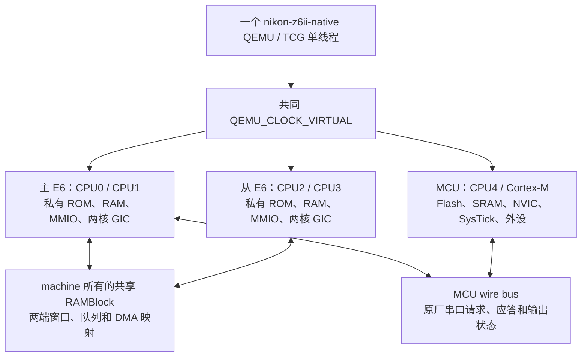

# 单实例 Z6II 架构与共同虚拟时间

默认 `native` 运行 `nikon-z6ii-native`：一个 QEMU 进程内有三个芯片域、五个 CPU。主 E6 与从 E6 各自保留两核、ROM、私有 RAM、MMIO 和 GIC；MCU 保留 Cortex-M、Flash、SRAM、NVIC 和自身外设。整机事件使用同一个 `QEMU_CLOCK_VIRTUAL`。

这是本次已经实现并可回归的模拟器架构。CPU 型号、板级等待、缓存一致性、供电和复位线的物理对应仍按已有固件与模型证据标明范围；完整原厂相机功能继续由各自的功能验收判断。



## CPU、地址空间与中断归属

| 芯片域 | QEMU 全局 CPU | 域内核编号 / MPIDR | CPU 模型 | 地址空间与中断 |
|---|---|---|---|---|
| 主 E6 | 0、1 | 0、1 | `nikon-z6ii-a15-arm-cpu` | 主 E6 私有根、独立两核 GIC |
| 从 E6 | 2、3 | 0、1 | `nikon-z6ii-a15-arm-cpu` | 从 E6 私有根、独立两核 GIC |
| MCU | 4 | 单核 | `nikon-ex1850-m4-r0p1-arm-cpu` | MCU 私有根、NVIC / SysTick |

QEMU 全局 CPU 编号只用于模拟器管理。两个 E6 的原厂代码都看到本芯片的 MPIDR 0 / 1，各自的 SGI、PPI 和 CPU interface 按域内编号路由。GIC 的 `first-cpu-index` 将两个域内编号分别映射到全局 0 / 1 与 2 / 3。MCU 中断经自己的 NVIC 处理。

三个 CPU cluster 与三个内存根分别建模。同一地址在两个 E6 中可以指向不同的私有 RAM；同一 E6 的两核共享本芯片 RAM。模型内部 DMA、MMIO 和观察器使用对应 engine 的 `AddressSpace`，避免默认系统地址空间把从 E6 的访问送到主 E6。

两个 E6 的既有共享窗口 alias 到同一个 machine 所有的 RAMBlock。重叠 DMA / CPU 窗口保留各自的 offset 和 size，guest 的实际写入由同一 backing 对象承载。文件用于保留本轮总线与 RAM 观察；运行期间由同一个 QEMU 执行芯片逻辑。物理缓存、总线竞争和线级传播延迟仍未恢复。

## 时间、频率与暂停

共同时间以虚拟纳秒记录。两个 E6 的计数器和 generic timer 按 48 MHz 计算，MCU 的 RCC / SysTick / 外设继续使用自身时钟配置和局部 epoch。共同时间不要求所有计数器频率、初值或相位相同。

E6 generic timer 在 native 中启用精确频率换算：读取按 `floor(virtual_ns × frequency / 1e9)` 计算，到期纳秒向上取整。48 MHz 的周期不能用整数 20 ns 替代，否则实际计数会变为 50 MHz。主动回归使用真实 guest `MRC` 读取 CNTVCT，并核对四核计数与共同虚拟时间。

MCU reset 时的 16 MHz HSI、RCC 切换和局部计数状态仍由 MCU 模型管理。其 SysTick、RTC、DMA、串口、wire polling 和模型等待计时器都使用 `QEMU_CLOCK_VIRTUAL`。源码中宿主实时计时仅用于外部 pad 的日志时间戳，不决定 guest 外设行为。

默认命令使用 `-accel tcg,thread=single` 与 `-icount shift=3,align=off,sleep=off`。五核和设备事件由一个虚拟时间调度。暂停 QEMU 后，共同时间和行为计时器一起冻结；最终 RAM 是同一暂停 epoch 内的顺序读取。宿主运行预算、日志时间和 guest 虚拟时间分别保存，icount 不是已经校准的真机 CPU 性能模型。

外部电池 peer 仍通过宿主 socket 提供明确声明的串口输入，使用 2 毫秒宿主应答等待。输入进入 MCU 后按 guest BRR / PCLK 的完整帧时间在公共虚拟时钟上交付，但当前外部应答策略没有保证虚拟时间的到达期限。历史运行保留过同一 `0x89` 请求成功、超时、重试成功的原厂返回；21:34 缩减场景与 21:43 默认场景分别有 2 次和 3 次认证请求，差异发生在 MENU 输入之前。现有记录不足以确定重试差异与电池弹窗的完整原因。电池功能失败与证据损坏分别验收，完整原厂调用与通信记录必须保留。

## 复位、MCU 通信和等待

MCU 的 AIRCR `SYSRESETREQ` 连接到 MCU 局部复位域。局部复位重新载入 MCU 原始向量，清理 NVIC / SysTick 和本地外设状态，保留 SRAM、两个 E6 的状态以及共同虚拟时间。整个 QEMU 的系统 reset 仍由整机复位处理。未来板级供电 / 复位线应显式连接到对应域；当前模拟拓扑不证明真实板卡的复位传播关系。

主 E6 与 MCU 使用同一个 MCU wire bus，记录原厂 USART 报文、请求、应答与输出状态。总线在每轮启动时重新创建，初始内容单独保存为不可变的 `cold-mcu-wire-initial.bus`，活动总线使用 `cold-mcu-wire.bus`。验收锁定初始快照的身份，不把执行期间变化的活动总线当作静态输入。

当前对主 E6 读取 `0x04282014 / 0x04282018` 而 MCU 尚未输出的情形，采用明确标注的 **virtual bus wait hypothesis**：只等待发起 scalar LDR 的核，其他核和 MCU 继续推进；MCU 实际输出后重试原指令；超时按共同虚拟时间计算。该机制不写入预设 ready 值，具体物理等待协议和复位网络仍待真机证据确认。

## 原厂入口与只读观察

两个 E6 各两核从已经验证的原厂更新镜像应用入口 `0x10020000` 执行，MCU 从完整原始 ROM 的 reset vector 执行。这个入口范围有原厂字节核对；从物理 Boot ROM / Flash / Loader 开始的全链冷启动另行验收。

一个 owner 管理同一进程的一条 RSP 与一条 QMP。线程身份来自实际 QOM CPU / cluster、RSP inferior / thread 和 MPIDR 读取。所有 RAM / 寄存器读取显式选择 CPU，VA 与 PA 分别标明。native 保留完整 TX / RX 字节及 IO 顺序，逐包检查 Host RAM / 寄存器写入为零。

`/machine` 的 `virtual-time-ns` 与 `architecture-state` 是只读属性，读取不触发 MMIO、IRQ ACK 或计时器动作。验收将 QOM 快照、时钟样本、入口、原厂观察事件和最终采样绑定到实际协议回复与 stop epoch。

最终采样必须包含五核寄存器、完整 256 KiB MCU SRAM、七个 SAISO / UI RAM 区域、两个 E6 的完整任务计划，以及 Loader 0B / 0C 两个区域。任务表和调度候选根由实际读取字节离线重算，缺少 root、read、saved 文件或伪造汇总均不能通过。任务 / Loader 计划在 QEMU 启动前随 recipe 一起锁定。

## 可重复验收

```sh
./z62 build --jobs 2
runtime/python/bin/python3.12 -B -E -s scripts/architecture_regression.py
./z62 run --profile native --architecture-only --binary rebuilt
./verify.sh latest-native
runtime/python/bin/python3.12 -B -E -s scripts/native_evidence_regression.py
```

主动结构回归保存在 `results/architecture-regressions/<id>/`。其 RAM 测试代码与寄存器写入明确标为合成 fixture，用实际 guest 指令检查：四核 MPIDR、私有 RAM、双向共享写入、域内 SGI、四核 PPI27 / 29 / 30、CNTVCT 频率、MCU SysTick、AIRCR 局部复位，以及暂停时间冻结。该报告与零写包原厂 native 的报告分别保存。

`--architecture-only` 选择有界原厂代码与架构观察，仍要求完整最终采样和没有到期未交付的输入。完整场景的 pad 期限是起点后 2、6.5、6.7、8、8.2、10、10.2 个共同虚拟秒；这是修正旧宿主秒误用后的有界外部场景，pin 物理身份与时长仍待测量。宿主预算不代替输入期限。未出现的第二种 `0x89` 电池请求、MENU / 照片 / 录像 / HDMI 缺口继续记录在本轮验收中。

完整功能门槛见 [ACCEPTANCE.md](ACCEPTANCE.md)，实际搬迁与离线重建方法见 [RUNNING.md](RUNNING.md)。

2026-10-25 21:43 的 [最新完整 native 运行](../results/20261025-214323-native-7e01f2/acceptance.md) 保留一个 PID、五核、完整两连接、共同停止 epoch 288、12.086141664 秒虚拟时间、完整 final 和零 Host 写包，7 个外部输入全部交付。[原始证据回归](../results/evidence-regressions/20261025-215034-dfdd6d/result.json) 通过。178 个 QMP 帧中 55 个非黑帧实际为电池通信错误弹窗；完整 TX / RX 为 171 / 314 字节，两次同种 `0x89` 返回均为 0，另一种必需请求仍未出现，正式场景返回 1。

[显示回归对照](../results/display-regressions/20261025-220134-a8a8c8/report.md) 将旧菜单、时基错误导致的全黑轮、提前 PC5 的 scanout 与缩减场景 OSD / 沙漏逐轮绑定到 binary 和原始像素。主 E6、从 E6、MCU 保持同一 `QEMU_CLOCK_VIRTUAL`；下一层未闭合的是外部应答到达的虚拟期限与原厂状态传播。真机历史对照见 [CAMERA-BATTERY.md](CAMERA-BATTERY.md)。
