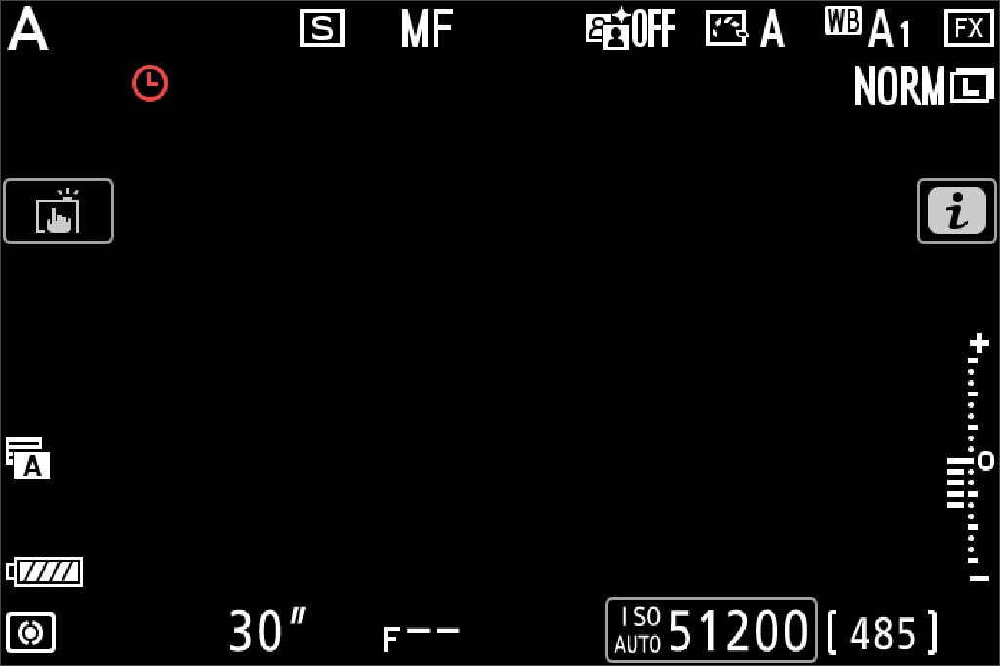

# Native method v0.0.2 — V44 exposure milestone

Version **0.0.2**, published as **v0.0.2**, records the V44 work completed on 2026-10-28. Original firmware initializes and publishes shutter, aperture and ISO values, and actual LCD pixels show `30" / F-- / ISO AUTO 51200` under explicitly selected device models. Changing-light metering and RAW/ISP completion remain pending.

## Inspect the source distribution

```sh
./z62 --version
./z62 native --check-only
./z62 native --print-command
```

Run from the repository root or invoke `z62` by its full path from another directory. Source inspection uses the prepared Python runtime when available and otherwise the host's `python3`; Python 3.11+ is recommended. `--check-only` verifies published sources, 64 observation sites and 25 input edges without requiring firmware, starting QEMU or contacting a camera. It reports source integrity separately from runtime and functional acceptance.

The current named native method selects [the v0.0.2 manifest](../profiles/baselines/native-v0.0.2/manifest.json). It checks the 119 native model source identities of the observed V44 build and pins its execution sources separately. The historical `profiles/baselines/native-menu-v0.01/` files retain their original identities. The low-level `./z62 run --profile native` command retains its existing defaults.

## Prepare local runtime and inputs

The Git repository contains QEMU sources, harness, profiles, tests, documentation and sanitized milestone evidence. It omits `runtime/`, `artifacts/`, `inputs/`, `results/`, upstream ROM projects and prebuilt boot blobs. A fresh clone is a source distribution; it does not contain a ready-to-run firmware installation.

Execution requires a separately prepared macOS Apple Silicon installation with Python, Pillow, NumPy, Meson, Ninja, pkgconf, build headers/libraries, the MCU wire tool, build manifests and compatible peripheral/reference inputs. `scripts/build.py` uses Apple Command Line Tools and the macOS SDK, targets `arm-softmmu`, disables blob installation and downloads, and compiles the contained source. Check these prerequisites using `./z62 doctor`.

Supply the unmodified firmware modules locally:

| Role | Required path | SHA-256 |
| --- | --- | --- |
| Master E6 | `inputs/firmware/master-original-with-crc.bin` | `bb83613121f843d65101da936d942acdc513d86dbd3abc26259d0d870d03f5d4` |
| Slave E6 | `inputs/firmware/slave-original-with-crc.bin` | `3fd8c2cbdf57fadb03f6d69b596b58a8703efdd61ae82572d5afeea0241a9ed5` |
| Modeled MCU | `inputs/firmware/ex1850_012000.bi.bin` | `4314c17d9a6676a4254aa4d74d4aa35411e3a793ea7056c06f9c83f160da3cb1` |

V44 additionally uses retained **conditional composite Flash input** and a complete **RTC backup bank with producer evidence**. Their payloads are local research material and are not distributed here:

| Input | Required identity and scope |
| --- | --- |
| Master Flash payload | Base `0x12a00000`, 23,068,672 bytes, SHA-256 `1594d90bde1ce7f8d856f8ac18294750e4a2c012cf3632fa32b5d0a6466fe4b5`; analysis-only composite |
| MCU RTC bank | 80 bytes, SHA-256 `8ef96592ab8615f10dfb3a4f5a7f4176e354ee4347907c4d0bf96f8d5b77b59f`; all five original producer evidence files required |

The existing Flash validator checks source ranges and actual payload bytes. The RTC validator requires a closed native producer run, original final QOM bytes, a common stop epoch, build bindings and zero debugger guest writes. A bare bank file or hand-written success metadata is insufficient. Complete shutdown and calendar continuity remain separate gates.

```sh
./z62 native --preflight-only \
  --persistent-input inputs/local/native-v0.0.2/persistent-input.json \
  --mcu-rtc-backup-input inputs/local/native-v0.0.2/rtc-backup-input.json

./z62 native \
  --persistent-input inputs/local/native-v0.0.2/persistent-input.json \
  --mcu-rtc-backup-input inputs/local/native-v0.0.2/rtc-backup-input.json
```

Alternatively, store both package-relative paths in the ignored `inputs/local/native-v0.0.2/inputs.json`, following [the selection example](examples/native-v0.0.2-inputs.example.json). A prepared installation can then run `./z62 native` directly. The effective recipe is printed before launch. Missing or mismatched inputs fail preflight; the method generates no substitutes.

The selected rebuild must contain the same 119 frozen native model source identities. A fresh rebuild can have a different binary hash and requires its own observation evidence. The reference build is `20261028-051343-6a9cac`, QEMU SHA-256 `acffb3c6b5d6752192c25c28b955f5f0fef7e3f8e02f0ea5b12e50e68f27783e`.

## Effective runtime method

```sh
./z62 run --profile native --binary rebuilt --seconds 1800 \
  --virtual-seconds 34 --display-observation \
  --ui-plan profiles/baselines/native-v0.0.2/ui-observation-plan.json \
  --pad-schedule profiles/baselines/native-v0.0.2/external-pad-schedule.json \
  --isp-commit-model next-frame-ae-v4 --image-status-model pending-v1 \
  --persistent-input inputs/local/native-v0.0.2/persistent-input.json \
  --persistent-output \
  --mcu-rtc-backup-input inputs/local/native-v0.0.2/rtc-backup-input.json \
  --mcu-rtc-backup-output
```

The named entry additionally freezes its milestone manifest, version, launcher and method source into the execution boundary. The low-level equivalent records its actual build, inputs and plans through the usual native launcher.

The 1800 seconds are a host safety budget; the observation window is 34 seconds on the shared `QEMU_CLOCK_VIRTUAL`. Allow the complete window to close. Run scenarios sequentially and keep execution sources and inputs unchanged until final evidence has been saved.

`next-frame-ae-v4` supplies explicitly modeled parameter/input notifications. `pending-v1` preserves unresolved image requests. They generate no image pixels, metering statistics or DMA completion, and do not write exposure properties or guest software-ready flags.

## Observed result and remaining gates

Reference run **20261028-051606-native-display-observation-7a9393** ends at **34,000,925,224 ns**, final stop epoch **2967**. One QEMU executes five modeled CPUs in three address spaces under the common clock. Both debugger connections closed, final sampling completed, and actual debugger guest RAM/register writes were **0**.

| Property | Original publication | Observed display |
| --- | --- | --- |
| Shutter `0x1800` | Tv = -5; code 12 | `30"` |
| Aperture `0x1801` | No valid lens aperture; code 0 | `F--` |
| Current ISO `0x1802` | Sv = 14; code 40 | `51200` |
| User ISO `0x1810` | Separate property; code 4 | ISO 100, distinct from current Auto ISO |

Tv = -5 represents 32 seconds mathematically; Nikon's preferred string is 30 seconds. The audit observed 20 calculation callbacks, 21 rational batches, one complete scalar triple and eight initialized collectors.



Complete text appears in reviewed black-plane samples near 32.704 and 33.576 virtual seconds. Earlier green samples omit shutter and ISO AUTO labels. Their widget cause and continuous visibility remain unresolved. Neither central plane is accepted as sensor live view.

Four menu responses are verified: up-row, confirmation, dialog dismissal and tab focus. First MENU pixels arrive **8.846305488 virtual seconds** after input, exceeding the unchanged **3-second** criterion. Strict stable MENU and reentry remain false.

| Gate | v0.0.2 status |
| --- | --- |
| Original numerical exposure publication and observed LCD text | Verified under the selected models |
| Changing-light metering feedback | Pending |
| RAW/ISP frame completion and sensor live view | Pending |
| Strict stable MENU / reentry | Pending; current timing fails the unchanged criterion |
| Physical Flash / Boot-ROM startup, complete shutdown / calendar continuity | Pending |
| Capture/storage, movie and HDMI | Separate unaccepted gates |

The [published evidence summary](evidence/native-v0.0.2.json) binds the result, image and local raw audit identities. It contains no firmware or debugger dump and cannot replace replaying retained evidence.

## Audit a closed run

Use the actual run name and an exact RGB visual review made against that run:

```sh
./z62 ui-verify RUN_DIRECTORY_NAME --require evidence
./z62 exposure-verify RUN_DIRECTORY_NAME \
  --visual-reviews results/YOUR_EXACT_RGB_REVIEWS.json \
  --out results/YOUR_NEW_EXPOSURE_AUDIT
```

`exposure-verify` reparses both actual debugger streams and binds original event registers, RAM, pointers, clocks and pixels to actual replies. Its positive scope is numerical publication and observed LCD text. It keeps metering, RAW/ISP completion and whole-camera checks false and does not promote the older broad `ui-verify --require exposure` gate.

Write new audit outputs. Preserve original runs, acceptance, the global UI index and the v0.01 comparison. The retained wire regression has 16 checks, including altered RAM with a recomputed hash, changed registers and changed clocks against actual replies.

Next work is active preview ingress and packing, actual unit/program/statistics payloads, slot lifetime and sourced completion/IRQ causes, followed by original AE feedback and strict menu retesting.
