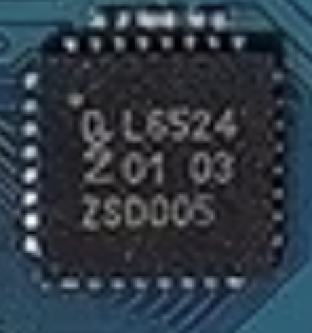

# PCAL6524 身份、总线归属与 native 模型

用户提供并明确确认为 Z62 主板的 PNG1 中，芯片顶部可读 `L6524`。NXP 官方 **PCAL6524DS Rev. 2.1，2025-07-03** 的第 4 页 Table 1 明确把 `L6524` 对应到 **PCAL6524HE / HUQFN32 / SOT1426-1**，封装本体为 5 × 5 × 0.56 mm。这一芯片身份属于厂家标记表与照片匹配的 Tier A；完整订购包装后缀和其在 Z62 上的电气连线继续单独核实。



原始 [NXP PDF](assets/hardware/z62-user-board-20261025/manufacturer/PCAL6524DS-rev2.1.pdf)、[页码摘录](assets/hardware/z62-user-board-20261025/manufacturer/PCAL6524DS-rev2.1-selected-pages.txt) 与 [来源 manifest](assets/hardware/z62-user-board-20261025/manufacturer/PCAL6524DS-rev2.1-source.json) 已保存在工程内。PDF 为 60 页、816662 字节，SHA256 为 `1d288143e686e995ec6b4d1a4bdbcf252ae42f772b536a222ac8a0a1db597797`。在线来源为 [NXP PCAL6524DS.pdf](https://www.nxp.com/docs/en/data-sheet/PCAL6524DS.pdf)。以下页码均为这一版原始 PDF 页码。

## 厂家确认的功能

PCAL6524 通过标准 I²C / SMBus 扩展 24 个 GPIO，适用于 MCU 引脚不足、按键、开关或不同电压的数字 I/O。RX651、STM32 或 E6 所带的兼容 I²C 控制器都可以作为主控，器件型号本身不确定板级总线主人。

| 项目 | 手册依据 | 对工程的含义 |
|---|---|---|
| 24 位 I/O，Fm+ 最高 1 MHz | 第 2–3 页 | GPIO 行为与 I²C 传输需要分别建模 |
| `VDD(I2C-bus)` 0.8–3.6 V | 第 2–3 页 | 对应 SDA / SCL 接口侧电压 |
| `VDD(P)` 1.65–5.5 V | 第 2–3 页 | 对应扩展 GPIO 侧；双电源支持两侧电平适配，实际 Z62 电源轨仍未知 |
| HUQFN32 引脚 29 SCL、30 SDA、31 `VDD(I2C-bus)`、32 INT | 第 5–6 页 | 提供后续走线核实的具体端点 |
| 引脚 26 ADDR、27 `VDD(P)`、28 RESET | 第 5–6 页 | 地址、电源有效与复位释放是独立前提 |
| INT 开漏、低有效；RESET 低有效 | 第 2–3、5–6 页 | 外部上拉、IRQ 路由和复位网络需要板级依据 |

这里的电平适配发生在 **I²C 接口侧与扩展 GPIO 侧**。器件对外提供 24 个 GPIO；手册描述的架构不能被用作下游 I²C 总线转换器或多路复用器模型。

第 7 页 Table 4 中，ADDR 接 VSS 时 A6…A0 为 `0100010`，即 **7 位地址 `0x22`**。线上写地址字节为 `0x44`，读地址字节为 `0x45`。ADDR 接 SCL、SDA、VDD 时分别是 7 位 `0x20`、`0x21`、`0x23`。表中 `44h` 使用包含 R/W 位的地址字节表示；当前工程的 `address7=22` 并不与手册矛盾。Z62 上的 ADDR 实际接法尚未观察。

## 当前 native 实现与直接观察

现有模型位于 [nikon-ex1850-reset.c](../src/qemu/hw/arm/nikon-ex1850-reset.c)，作为 **CPU4 / ARM Cortex-M4 MCU 的 I²C1 外部候选设备**。`ex1850_i2c_pin_route()` 检查原厂代码实际写入的 GPIO 控制状态：PB8=SCL、PB9=SDA、AF4、开漏。`profiles/native/mcu.json` 明确启用 released I²C、PCAL6524 与 24 位 pad 输入。

在 [22:52 固定运行](../results/20261025-225252-native-f20ee5/acceptance.md) 的 `qemu.log` 中，约 `607874384 ns` 已观察 `address7=22`、reg00 的输入读取，随后读取 reg01 / reg02。日志保留 `PCAL6524_candidate` 和 `physical_camera_sample=0` 标签。这是 ARM 原厂程序经当前模型访问该外部设备的执行证据。

模型实现输入、输出、方向、极性、上下拉、输入锁存、边沿与中断状态等寄存器行为。它按显式声明的供电有效、RESET 释放、ADDR 接 VSS 条件初始化；MCU I²C 控制器局部 reset 保持外部 expander 状态。debounce、general-call reset、device ID 及完整物理 INT / RESET 路由尚未完整实现或验证，因此仍是有范围的 PCAL 协议模型。

MENU 场景由 [native_unified_pads.py](../scripts/native_unified_pads.py) 在共同虚拟时间 6.5 / 6.7 秒改变候选 mask `0x200`。pad 输入已交付仅证明外部引脚场景发生；物理按键映射、稳定菜单导航和电气 IRQ 因果仍待验收。

## RX651 关联的证据边界

照片中 `R5F56519AD` 对应 RX651 系列，其存在已确认。**RX651 控制 PCAL6524 在器件接口上可行，Z62 实际的总线归属仍未知。** 当前原厂 ARM 路径值得继续核实，也需要考虑共享 I²C、板卡版本或其它连接方式；这些目前都是待证假设。

后续需要将 PCAL 的 SDA、SCL、INT、RESET 与 ADDR 端点，和 RX651 / ST 控制器的实际引脚或原厂初始化及事务对应起来。仅凭器件相邻、通用用途或显示恢复，不能确定 RX651 承担电池、镜头、快门或防抖任务，也不能将缺失的第二种 `0x89` 归因于该器件。

若原厂固件与接口证据确认 RX651 的职责，应为它建立自身 CPU / 地址空间、外设、复位和 IRQ 域，并加入同一个 `nikon-z6ii-native` 与共同 `QEMU_CLOCK_VIRTUAL`；保留各芯片的局部时钟频率。PCAL 则挂到经证据确认的总线，由真实 GPIO / IRQ / reset 行为传播状态。

[两张主板的编号标注与坐标](assets/hardware/z62-user-board-20261025/annotations/manifest.json) 保留原图 SHA256。可用随包 Python 重新生成到一个新目录：

```sh
runtime/python/bin/python3.12 -B -E -s scripts/hardware_photo_report.py --output docs/assets/hardware/z62-user-board-20261025/annotations-review
```

[硬件总览](motherboard-architecture.md) · [当前架构](ARCHITECTURE.md) · [功能验收](ACCEPTANCE.md)
